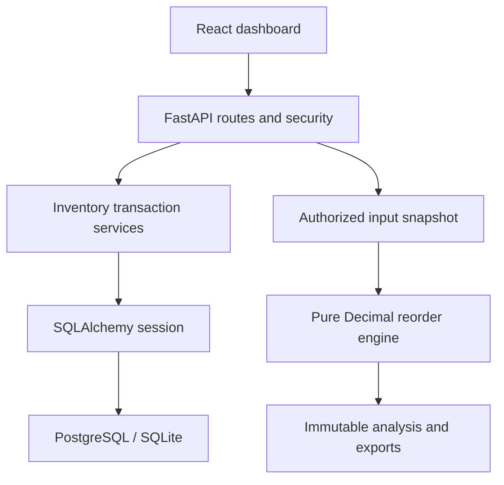

# Engineering conception

Account is the first-release ownership boundary: every supplier, warehouse, product, order, demand observation and analysis has an owner. Owned balances are reached through owned products and warehouses. No UUID alone grants access.

main.py: application, registration/login/logout, safe errors, static frontend. routes.py: inventory HTTP contracts. services.py: ownership queries, transaction replay, conditional stock updates, order views and analytical snapshot. models.py: relational schema and invariants. schemas.py: explicit field limits and validation. engine.py: deterministic calculations. imports.py: row validation. security.py: Argon2 and hashed sessions/CSRF. database.py: request-scoped session. migrations/: versioned schema changes.

User has products, warehouses, suppliers and analyses. Product refers to its preferred supplier. Balance joins product and warehouse, with a unique key and quantity >= 0. Movement is an append-only ledger entry. PurchaseOrder has supplier/warehouse and lines. Each line tracks ordered and received quantities. ReceiptEvent stores receipt date/quantity for lead-time reporting. DemandObservation stores sold units/revenue independently of physical movements. RequestRecord stores replay keys, input hashes and completed responses. Analysis stores input snapshot, output, engine version and time.

Atomic mutations commit business writes and RequestRecord together. Concurrent balance deductions use conditional SQL, not a stale Python read. PostgreSQL purchase receiving/cancellation locks the order row, then conditionally increments line received quantities. Failed multi-line receipts roll back everything. Transfer debits and credits share a transaction.

This app is a modular monolith. Split routers, services and repository adapters into packages when scale warrants it. Keep the pure engine independent. Production integration should add stable external source IDs, webhook verification, import overlap reconciliation and background jobs rather than placing those duties into formulas.
